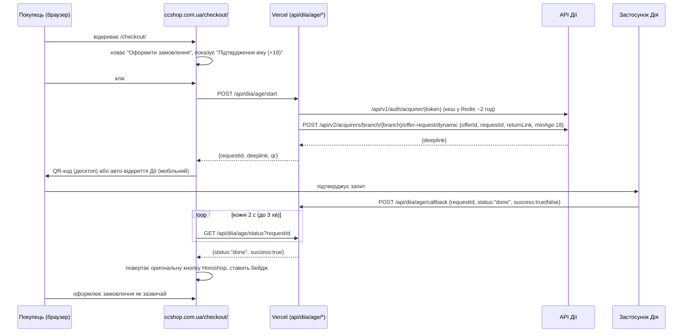

# Перевірка віку 18+ через Дію на `ccshop.com.ua/checkout/#18`

Сайт працює на **Horoshop** (серверного коду там немає), а Дія надсилає результат перевірки **тільки на серверний callback** і вимагає секретний acquirer-токен. Тому рішення — один Vercel-проєкт, який і роздає фронт-скрипт, і виконує серверну частину як Serverless Functions.

| Частина | Де | Що робить |
|---|---|---|
| Фронт-скрипт | `public/diia-age-check.js` → `https://<проєкт>.vercel.app/diia-age-check.js` | На `/checkout/#18` підміняє кнопку «Оформити замовлення» на «Підтврдження віку (+18)», показує QR/відкриває Дію, опитує статус |
| Функції | `api/diia/age/start.js`, `status.js`, `callback.js`, `api/health.js` | Сесійний токен Дії, діплінк з `minAge: 18`, прийом callback'а, статус |
| Спільна логіка | `lib/diia.js` | Конфіг, клієнт API Дії, сховище (Upstash Redis), CORS |
| Inline-варіант для Horoshop | `horoshop/diia-age-check.html` (генерується з `public/…js`) | Якщо хочеться вставити код, а не `<script src>` |

## Як це працює



Скрипт активується тільки якщо `location.pathname` = `/checkout/` **і** `location.hash` = `#18`. На звичайному `/checkout/` він нічого не робить. Результат живе в `sessionStorage` вкладки — перемальовування чекаута Horoshop або повернення з Дії по `returnLink` не вимагають повторної перевірки.

## Деплой на Vercel (акаунт `mrktng1`)

### 1. Проєкт

```bash
npm i -g vercel            # або використовувати npx vercel
vercel login
vercel link --scope mrktng1   # створити новий проєкт, Root Directory = корінь цього репозиторію
```

Або через веб: Vercel → Add New → Project → імпорт цього репозиторію з Git. Framework Preset — **Other**, build command порожній, output порожній. `vercel.json` уже задає регіон `fra1` (Франкфурт) і кешування скрипта.

### 2. Сховище (обов'язково)

Функції stateless — стан запитів і кеш сесійного токена мають жити поза процесом. Код обирає сховище автоматично:

1. **Vercel Blob** (за замовчуванням, рідне для Vercel, без Marketplace): `vercel blob create-store cc-diya-store --access private --region fra1 --yes` — створює private-store і сам додає `BLOB_READ_WRITE_TOKEN` у проєкт. (Store `cc-diya-store` уже створено.)
2. **Upstash Redis** (опціонально, якщо задано `KV_REST_API_URL/TOKEN` — має пріоритет).
3. Пам'ять процесу — лише для локалки; на Vercel ненадійно.

`/health` показує активне сховище: `"storage":"blob"`.

### 3. Змінні оточення

```bash
cp .env.example .env           # перевірити значення
sh tools/vercel-env.sh         # заллє всі змінні з .env у production + preview
```

Або вручну в Vercel → Settings → Environment Variables:

| Змінна | Значення |
|---|---|
| `DIIA_HOST` | `https://api2s.diia.gov.ua` — тест; `https://api2.diia.gov.ua` — прод |
| `DIIA_ACQUIRER_TOKEN`, `DIIA_AUTH_ACQUIRER_TOKEN` | видані Дією (у `.env.example` — тестові) |
| `DIIA_BRANCH_ID`, `DIIA_OFFER_ID` | відділення й офер зі скоупом `documentIdentification: ["age-range"]` |
| `ALLOWED_ORIGINS` | `https://ccshop.com.ua` (CORS + захист `/start`) |
| `RETURN_LINK` | `https://ccshop.com.ua/checkout/#18` |
| `CALLBACK_TOKEN` | необов'язково; якщо Дія шле `Authorization: Bearer …` на callback |

### 4. Деплой і перевірка

```bash
vercel --prod
curl https://<проєкт>.vercel.app/health
# {"ok":true,"diiaHost":"https://api2s.diia.gov.ua","storage":"redis",...}
```

Повний цикл без застосунку Дія (симуляція callback'а):

```bash
B=https://<проєкт>.vercel.app
R=$(curl -s -X POST $B/api/diia/age/start -H "Origin: https://ccshop.com.ua" -H "Content-Type: application/json" -d '{}')
echo $R | cut -c1-200                       # requestId, deeplink, qr
ID=$(echo $R | sed 's/.*"requestId":"\([^"]*\)".*/\1/')
curl -s "$B/api/diia/age/status?requestId=$ID"     # pending / diiaStatus: initialized
curl -s -X POST $B/api/diia/age/callback -H "Content-Type: application/json" \
     -d "{\"requestId\":\"$ID\",\"status\":\"done\",\"success\":true}"
curl -s "$B/api/diia/age/status?requestId=$ID"     # {"status":"done","success":true}
```

### 5. Повідомити Дію

Передати команді Дії URL callback'а — **`https://<проєкт>.vercel.app/api/diia/age/callback`** — як «точку інтеграції партнера» для вашого acquirer'а. Без цього Дія не знатиме, куди слати `{"success": true/false}`, і перевірка ніколи не завершиться. Якщо згодом підключите власний домен (напр. `diia-age.ccshop.com.ua`) — оновити URL і в Дії.

## Підключення у Horoshop

Один рядок у Horoshop → Налаштування → Сайт → Код HTML/JS → «Перед `</body>`»:

```html
<script defer src="https://<проєкт>.vercel.app/diia-age-check.js"></script>
```

`apiBase` скрипт бере з власної адреси, нічого налаштовувати не треба. Перевизначити параметри (адресу API, текст кнопки, селектор) можна перед підключенням:

```html
<script>window.DIIA_AGE_CONFIG = { buttonText: 'Оформити з підтвердженням віку (18+)' };</script>
<script defer src="https://<проєкт>.vercel.app/diia-age-check.js"></script>
```

Якщо потрібен inline-варіант (`<script defer>(function(){…})()</script>`), згенерувати його з актуальною адресою і вставити вміст файлу:

```bash
node tools/build-inline.js https://<проєкт>.vercel.app   # → horoshop/diia-age-check.html
```

Перевірка: відкрити `https://ccshop.com.ua/checkout/#18` з товаром у кошику — замість «Оформити замовлення» має бути «Підтврдження віку (+18)».

Скрипт не чіпає логіку Horoshop: оригінальна кнопка `.j-submit` ховається (`display:none`) і повертається після підтвердження, її `disabled`-стан і валідація лишаються за Horoshop. Накриваються обидва макети чекаута — десктопний `.checkout-footer__row .j-submit` і мобільний `.form-item--offset button.j-submit` (кнопки логіну/реєстрації не чіпаються). `MutationObserver` повторно накриває кнопку після перемальовування чекаута; на мобільному одразу відкриває `https://diia.app/...`, на десктопі показує QR (PNG приходить з функції, зовнішніх CDN немає); таймер 3 хв = час життя діплінка.

## Брендинг кнопки (брендбук Дії)

Кнопка «Підтврдження віку (+18)» зроблена за [брендбуком Дії](https://diia.gov.ua/img/diia-october-prod/sites/1/uploaded-files/_%D0%92%D0%B8%D0%BA%D0%BE%D1%80%D0%B8%D1%81%D1%82%D0%B0%D0%BD%D0%BD%D1%8F_%D0%BB%D0%BE%D0%B3%D0%BE%D1%82%D0%B8%D0%BF%D1%83_%D0%94%D1%96%D1%8F_2025.pdf) (стор. 7, 8, 13, 15):

| Вимога брендбука | Реалізація |
|---|---|
| Для кнопок: мінімальна висота лого 24px | лого 32px |
| Мінімальна відстань до верхньої/нижньої стінки плашки 8px | 8px (висота кнопки 48px) |
| Рекомендована відстань від тексту до лого — 1/4 висоти лого | 8px (32/4) |
| Чорна плашка (HEX #000000, суцільна заливка, без градієнтів) | `#000`, `border-radius: 999px` |
| На темному фоні — контурна версія лого, на світлому — основна | у чорній кнопці — контурна, у білій модалці — основна (чорна) |
| Не використовувати растрову версію, не змінювати пропорції/радіус/шрифт/заливку, без тіні та прозорості | вбудований SVG (вектор), без змін, `box-shadow: none`, `opacity: 1` |
| Лого не всередині іншої форми, не менше сусідніх елементів | лого окремим елементом, 32px при тексті ~16px |
| Написання: Дія — з великої, без лапок, відмінюється («через Дію») | дотримано в усіх текстах |

Лого: `public/diia-logo.svg` (основна) і `public/diia-logo-outline.svg` (контурна) — векторизовані з офіційного PNG скриптом `tools/vectorize-diia-logo.py` (потрібні `potracer pillow numpy scipy`); ті самі SVG вбудовані в `public/diia-age-check.js`. Якщо Мінцифри надішле офіційні SVG — замінити константи `LOGO_FILLED` / `LOGO_OUTLINE`.

## Відділення та офер у Дії

У тестовому середовищі вже створено (ID у `.env.example`):

- branch `b332d3f7…` — «CC Shop — перевірка віку (checkout)», `scopes.documentIdentification: ["age-range"]`, `offerRequestType: dynamic`
- offer `038b3bce…` — «Підтвердження віку 18+ (ccshop.com.ua)»

Для проду (інший токен) створити заново:

```bash
node tools/diia-setup.js create        # виведе DIIA_BRANCH_ID / DIIA_OFFER_ID
node tools/diia-setup.js branches      # перелік
node tools/diia-setup.js offers <id>   # офери відділення
```

Зауваження: у документації скоуп називається `age-range`, але API приймає його **тільки** в ключі `scopes.documentIdentification`, не в `scopes.sharing` (там — перелік документів, `age-range` відхиляється з 422).

## Локальна розробка

```bash
npm install
cp .env.example .env
npm run dev                   # http://localhost:3000 — емуляція роутингу Vercel для api/** і public/
```

(або `vercel dev`, якщо проєкт уже зв'язаний).

## Що перевірено

- Тестове API Дії (`api2s`): сесійний токен, створення відділення/офера, діплінк з `minAge: 18`, статус (`initialized`).
- Функції локально (емуляція Vercel): CORS лише для дозволених origin, 403 для чужих, 405 для неправильного методу, preflight 204, callback з `X-Document-Request-Trace-Id` у будь-якому регістрі та з `Content-Type: aplication/json` (як у доках Дії), цикл `start → status(pending) → callback → status(done)` для `success:true` і `false`; обидва сховища — пам'ять і Redis (REST-протокол Upstash, кеш токена між викликами).
- Фронт у Chromium на mock-копії чекаута Horoshop: активація лише з `#18`, підміна кнопки, модалка з QR, успіх (повернення кнопки + бейдж), відмова, повторне накриття після перемальовування, збереження стану після перезавантаження.

Не перевірялося: застосунок Дія на телефоні з тестовим обліковим записом.

## Обмеження

- Перевірка на фронті — UX-бар'єр, а не серверна гарантія: технічно покупець може відкрити `/checkout/` без `#18`. Якщо потрібна жорстка заборона, Horoshop має передавати ознаку в замовлення або менеджер перевіряє вручну.
- Ліміти Hobby-плану Vercel цілком достатні: виклики до Дії тривають < 1 с, стандартного таймауту функції вистачає.
- Текст кнопки взято дослівно з ТЗ («Підтврдження»); виправити можна через `window.DIIA_AGE_CONFIG.buttonText`.
